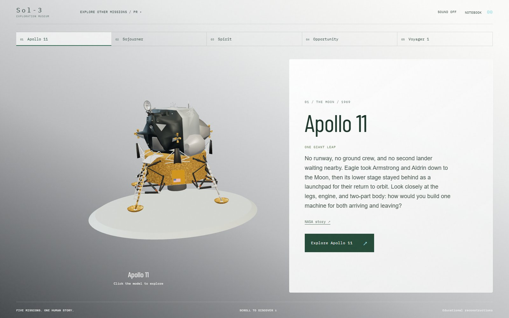

# Sol-3: The Human Trace

A 3D space exploration museum built by Team Petrova for students and space enthusiasts.

Explore five missions, take spacecraft hardware apart, and learn from NASA sources with Miso, a fictional alien copilot.

[Visit Sol-3](https://nasa-space-app-challenge.aryan-sharar.workers.dev/) | [Project status](docs/STATUS.md) | [Sources and credits](docs/ASSETS.md)



## Explore

Choose any mission from the museum. Approach the site, inspect its hardware, and follow the evidence at your own pace. Field guides provide more detail, and a personal notebook saves your thoughts and questions in your browser.

| Mission | Location | Highlights |
| --- | --- | --- |
| Apollo 11 | Moon | Eagle, landing hardware and surface experiments |
| Sojourner | Ares Vallis, Mars | The rover, Pathfinder and landing systems |
| Spirit | Gusev Crater, Mars | Rover engineering and evidence of past water |
| Opportunity | Meridiani Planum, Mars | Minerals, meteorites and rover endurance |
| Voyager 1 | Interstellar space | Communications and the Golden Record |

Miso's questions are optional and appear after the approach. Completed discoveries remain available during the session; notebook writing stays on your device.

Historical facts link to NASA sources. The alien expedition, Mars astronaut and shuttle journeys are fictional. Reconstructed scenes are teaching models, not exact site surveys.

## Controls

- **Walk:** hold W or Up Arrow. Release to stop, or use Skip walk.
- **Fly:** use WASD or arrow keys to steer and Space to brake.
- **Inspect:** select an object, drag to rotate, and scroll to zoom. Select parts to examine them separately.
- **Return or pause:** press Escape or use the on-screen control.

On-screen controls and reduced-motion support are available.

## Tech stack

| Area | Tools |
| --- | --- |
| Frontend | React, TypeScript and CSS |
| 3D graphics | Three.js, React Three Fiber and Drei |
| Animation and scrolling | GSAP and ScrollTrigger |
| App state | Zustand |
| Storage | Browser localStorage for notes, sessionStorage for question history |
| Models and assets | Blender, Python scripts and NASA imagery/models |
| Build tools | Vite, Node.js and npm |
| Testing | Playwright, TypeScript checks and Node.js simulation tests |
| Hosting | Cloudflare Workers Static Assets |
| Deployment and source control | Wrangler CLI, Git and GitHub |

The app runs in the browser. There is no separate backend API or database; Cloudflare serves the built site and its assets. Exploration progress stays in memory during the session.

## Run locally

Use Node.js 22 or newer.

```sh
npm install
npm run dev
```

Open the local URL printed by Vite.

```sh
npm run typecheck
npm run build
npx playwright test --project=desktop
```

Desktop tests require the dev server and Chrome. Mobile testing is currently deferred. See [project status](docs/STATUS.md) for completed checks and known limitations.

## Development

All missions share one persistent 3D canvas.

Read [AGENTS.md](AGENTS.md) and [project status](docs/STATUS.md) before making changes.

- [Product scope](docs/PRODUCT.md)
- [Architecture](docs/ARCHITECTURE.md)
- [Design system](docs/DESIGN_SYSTEM.md)
- [Exploration and navigation](docs/EXPLORATION_MUSEUM.md)
- [Assets and provenance](docs/ASSETS.md)

## Deployment

With access to the existing Cloudflare account:

```sh
npm run build
npx wrangler deploy
```

The configuration publishes to the existing Sol-3 Worker. Pushing to GitHub does not deploy the site.
