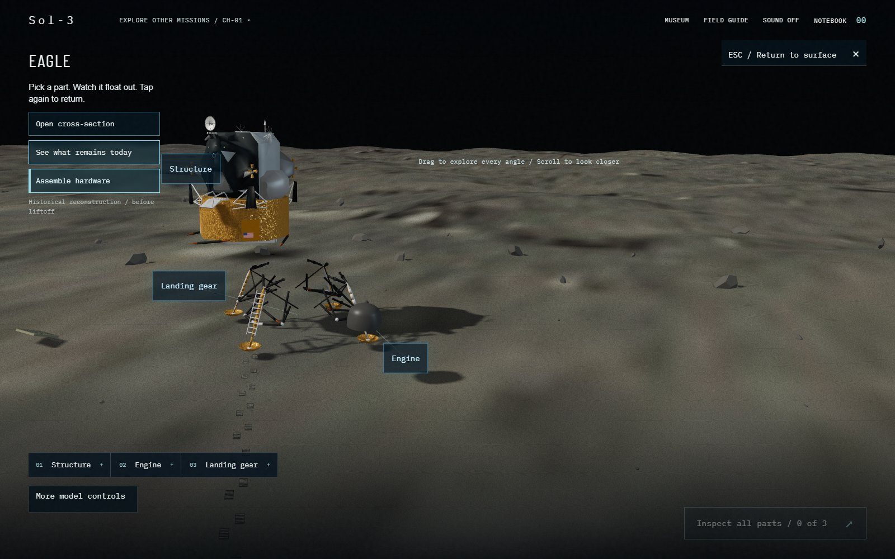
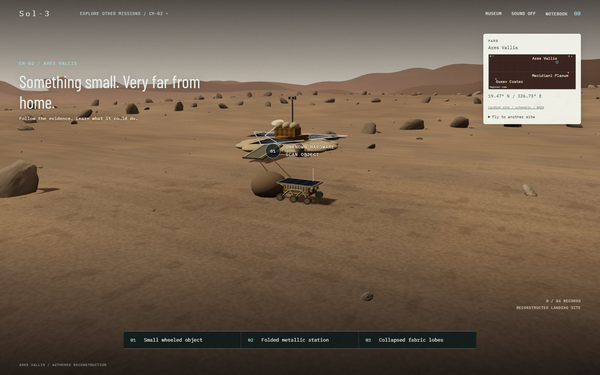
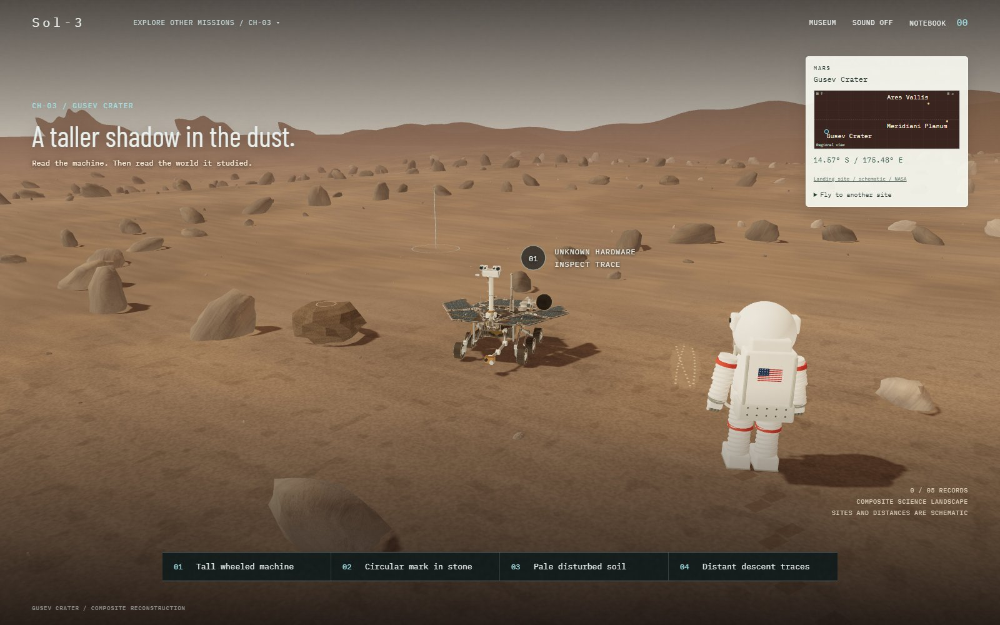
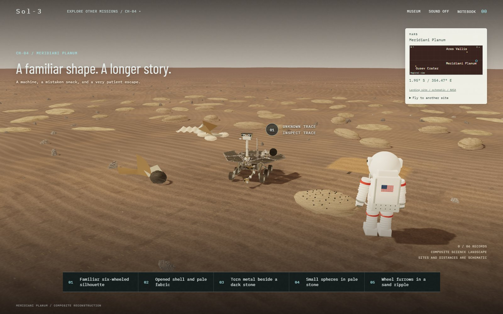
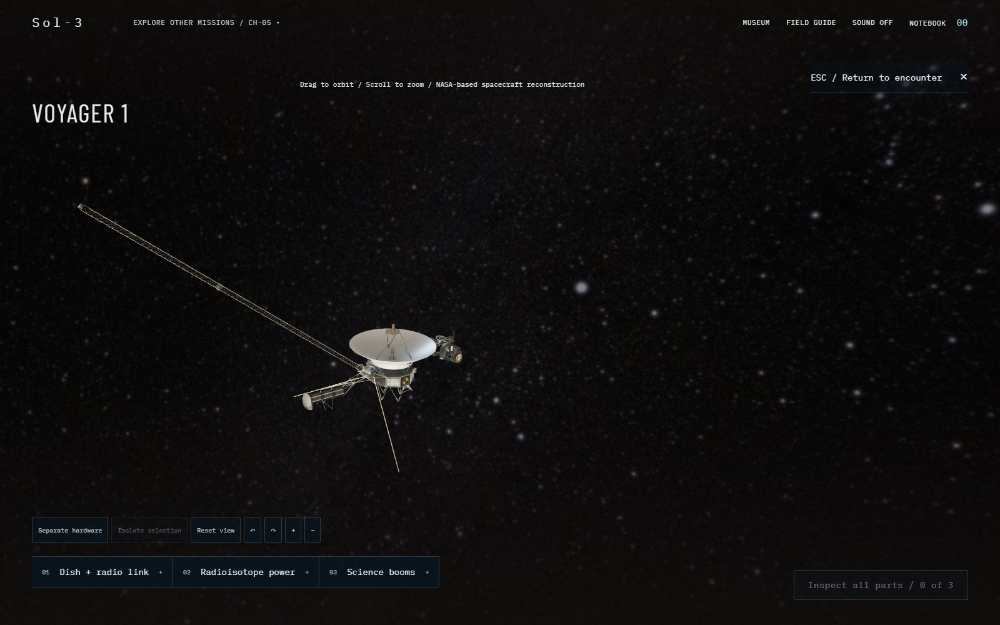

# Sol-3: The Human Trace

**A cinematic exploration museum by Team Petrova.** Discover the machines humans sent beyond Earth, ask questions with Miso, and build your own notebook of evidence.

[**Play Sol-3**](https://nasa-space-app-challenge.aryan-sharar.workers.dev/) ? [Project status](docs/STATUS.md) ? [Sources & credits](docs/ASSETS.md)


## Five missions. One curious explorer.

Start in the museum, browse the exhibits, and choose a mission. Land, walk toward unknown hardware, open an inspection, and follow the clues. Return to **MUSEUM** to resume browsing, or use **EXPLORE OTHER MISSIONS** to revisit any chapter. Discoveries stay in your notebook.

| Chapter | Destination | Discover |
| --- | --- | --- |
| 01 ? Apollo 11 | Tranquility Base, Moon | Eagle, its separable assemblies, experiments and human traces |
| 02 ? Sojourner | Ares Vallis, Mars | The small rover, Pathfinder and landing evidence |
| 03 ? Spirit | Gusev Crater, Mars | Rover engineering, rock abrasion and clues in silica-rich soil |
| 04 ? Opportunity | Meridiani Planum, Mars | Mineral clues, a meteorite, dune traction and a long mission |
| 05 ? Voyager 1 | Between the stars | Spacecraft hardware, distant signals and the Golden Record |

Miso is a fictional alien copilot. NASA-linked field notes distinguish historical evidence from interpretation. The Mars astronaut, shuttle journeys, terrain placement and separated hardware are educational reconstructions, not an exact survey or a claim that humans visited Mars.

## Inside the experience

### Apollo 11 ? Take Eagle apart

Inspect the complete lander, separate its assemblies, or reveal the descent stage left on the Moon. Rotate, zoom and reset the model while exploring its engineering.



### Mars ? Walk toward the evidence

Chapters 2?4 share a walking astronaut, warm Martian soil and question-led investigations. Sojourner is small beside a person; Spirit and Opportunity stand much taller. Models use NASA-referenced dimensions with a consistent 1.85 m fictional suited visitor.

| Sojourner ? Ares Vallis | Spirit ? Gusev Crater |
| --- | --- |
|  |  |



Optional Miso questions draw from five sourced questions per chapter without immediate repeats. Skipping, approaching hardware or opening an inspection dismisses the introduction for that visit; it does not follow you through exploration.

### Voyager 1 ? A traveler between the stars

Explore the spacecraft and the ideas it carries: communication across distance, the Golden Record and our view of Earth.



Screenshots above were captured from the application on desktop for the October 21, 2026 release. NASA imagery and model provenance are documented in [ASSETS.md](docs/ASSETS.md).

## Controls

| Activity | Controls |
| --- | --- |
| Walk on Moon or Mars | Hold **W / ?** or the on-screen walking control; release to stop; skip is available |
| Fly and land | **WASD / arrows** to steer, **Space** to brake; assist, pause and skip controls are available |
| Travel between Mars sites | Open **Fly to another site**; **W / ?** thrust, **A / D** steer, **Space** brake |
| Inspect hardware | Select a clue; orbit, zoom, select assemblies and use **Reset view** |
| Leave inspection / pause | **Escape** or the visible return/pause control |

Reduced motion bypasses walking and provides direct arrivals. Historical landing coordinates and simulated shuttle positions are labeled separately. Apollo and Voyager have no minimap; maps yield during walking and hardware inspection.

## Latest changes ? October 21, 2026

- Added Apollo-style astronaut walking to Sojourner, Spirit and Opportunity, with stride animation, footprints, pause, skip and reduced-motion arrival.
- Fixed optional questions reappearing after walking or inspection exit, while preserving random questions on new visits.
- Unified astronaut scale and calibrated Eagle and Mars rover heights against NASA references; corrected ground contact.
- Added this screenshot tour. See [release notes](docs/RELEASE_2026-10-21.md) for the comparison with the previous deployment.

## Run locally

Use Node.js 22 or newer, then:

```sh
npm install
npm run dev
```

Open the URL printed by Vite, normally `http://127.0.0.1:5173/`.

```sh
npm run typecheck
npm run build
node tests/flight.cjs
node tests/navigation.cjs
node tests/surface-flight.cjs
node tests/mission-questions.cjs
npx playwright test --project=desktop
```

Playwright requires the dev server and Chrome. `npm run test:e2e` includes both configured desktop and mobile projects; mobile testing is currently deferred at the project owner's request. See [Status](docs/STATUS.md) for checks actually run and known limitations.

## Build and source guide

React 19, TypeScript and Vite power the interface. React Three Fiber and Three.js share one persistent canvas across the museum and mission scenes. Zustand manages expedition state; authored Blender models and NASA assets support the exhibits.

- [Product scope](docs/PRODUCT.md) ? [Architecture](docs/ARCHITECTURE.md) ? [Design system](docs/DESIGN_SYSTEM.md)
- [Exploration and simulated-navigation contract](docs/EXPLORATION_MUSEUM.md)
- [Spirit source audit](docs/CHAPTER_3.md) ? [Opportunity source audit](docs/CHAPTER_4.md) ? [Voyager source audit](docs/CHAPTER_5.md)
- [Hardware journey contract](docs/HARDWARE_JOURNEY.md) ? [Asset provenance](docs/ASSETS.md)

Read `AGENTS.md` and `docs/STATUS.md` before development. Current scope ends at Voyager 1. Runtime assets live in `public/`; local pitch-video production, temporary output and generated QA captures are separate from the published application.

The editable rover models live in `assets/blender/`. Rebuild with Blender 4.5:

```sh
blender --background --factory-startup --python scripts/build-spirit.py
blender --background --factory-startup --python scripts/build-opportunity.py
```

## Deploy

```sh
npm run build
npx wrangler deploy
```

Sign into the existing Cloudflare account first. `wrangler.jsonc` deploys `dist` to the existing `nasa-space-app-challenge` Worker. A GitHub push alone does not deploy the website. Deployment receipts are recorded in [Status](docs/STATUS.md).
